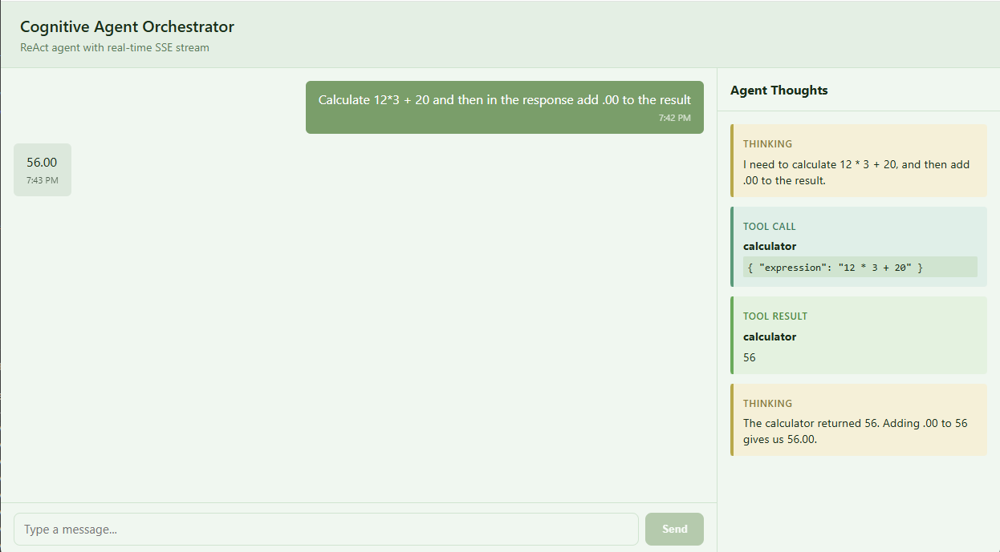

# Cognitive Agent Orchestrator (September 2024 - January 2025)

> **Snapshot (2024-2025).** Published in 2026, keeping the stack of the time; not maintained. Limitations: the action parser (`agent-loop.ts:20`) breaks on parentheses inside the arguments; `new Function` in the calculator is safe because of the whitelist in `calculator.tool.ts:18`; the backend has no tests and no lockfile, and `cors()` is open. See [Limitations](#limitations).

A minimal but complete **ReAct (Reasoning + Acting)** cognitive agent orchestrator. It exposes a deterministic state-machine-driven agent loop on the backend and streams every thought, tool call, tool result, and final answer to an Angular 18 zoneless frontend via **Server-Sent Events (SSE)**.

The project is a monorepo with two applications:

- `agent-backend` — Node.js + Express + TypeScript ReAct engine.
- `agent-frontend` — Angular 18 standalone zoneless UI.

<p align="center">
  
</p>

---

## What is ReAct?

ReAct interleaves **reasoning** (`THOUGHT:`) with **actions** (`ACTION:`). The agent can decide to invoke a tool, observe the result, reason again, and finally produce a `FINAL_ANSWER:`.

```
User prompt
     |
     v
THOUGHT: I need to calculate this.
ACTION: calculator({"expression":"15*7+3"})
     |
     v
TOOL RESULT: 108
     |
     v
THOUGHT: The calculation is complete.
FINAL_ANSWER: The result is 108.
```

### ReAct flow diagram

```
+------+   start    +------------+
| IDLE | ---------> | REASONING  |
+------+            +------------+
                       |
          +------------+------------+
          |                         |
          v                         v
    +---------+              +----------+
    | ACTING  |<-- action    |  DONE    |<-- final
    +---------+              +----------+
          |
    observation
          v
    +-----------+
    | OBSERVING |
    +-----------+
          |
    llm_response
          |
          v
    +------------+
    | REASONING  | (loop, max 10 iterations)
    +------------+
```

---

## Technology stack

| Layer        | Technology                         | Version       |
| ------------ | ---------------------------------- | ------------- |
| Runtime      | Node.js                            | 20.18.0 LTS   |
| Backend      | Express                            | 4.21.0        |
| Backend lang | TypeScript                         | 5.5.4         |
| Frontend     | Angular                            | 18.2.8        |
| Frontend CLI | Angular CLI                        | 18.2.8        |
| Frontend lang| TypeScript                         | 5.5.4         |
| Reactivity   | Angular Signals (zoneless)         | RxJS 7.8.1    |
| Dev runner   | tsx                                | 4.19.0        |
| Infra        | Docker Compose                     | v2.29         |
| Optional LLM | Ollama                             | 0.4.7         |
| Optional model| Qwen 2.5 Coder 7B                 | nov 2024      |

The backend Docker image is `node:20.18.0-bookworm-slim`. The frontend builder uses the same Node image and the runtime uses `nginx:stable-alpine`.

---

## Operating modes

The backend selects the LLM provider via the environment variable `LLM_PROVIDER`.

### `simulated` (default)

No external dependencies. A deterministic parser decides which tool to call based on keywords in the user prompt. Perfect for quick demos and CI.

### `ollama`

Connects to an Ollama server and uses **Qwen 2.5 Coder 7B**, published in November 2024 under the Apache 2.0 license. The backend sends a strict system prompt that teaches the model the ReAct format and parses `THOUGHT` / `ACTION` / `FINAL_ANSWER` blocks.

---

## Project structure

```
cognitive-agent-orchestrator/
├── agent-backend/
│   ├── src/
│   │   ├── core/
│   │   │   ├── agent-event.ts
│   │   │   ├── agent-loop.ts
│   │   │   └── state-machine.ts
│   │   ├── providers/
│   │   │   ├── llm-provider.interface.ts
│   │   │   ├── simulated-provider.ts
│   │   │   └── ollama-provider.ts
│   │   ├── tools/
│   │   │   ├── tool.interface.ts
│   │   │   ├── calculator.tool.ts
│   │   │   ├── weather.tool.ts
│   │   │   └── search.tool.ts
│   │   ├── server.ts
│   │   └── index.ts
│   ├── package.json
│   ├── tsconfig.json
│   └── Dockerfile
├── agent-frontend/
│   ├── src/app/
│   │   ├── core/
│   │   │   ├── models/
│   │   │   │   ├── agent-event.model.ts
│   │   │   │   └── chat-message.model.ts
│   │   │   └── services/
│   │   │       └── agent-stream.service.ts
│   │   ├── features/
│   │   │   ├── chat-window/
│   │   │   │   ├── chat-window.component.ts
│   │   │   │   ├── chat-window.component.html
│   │   │   │   └── chat-window.component.scss
│   │   │   └── agent-thoughts/
│   │   │       ├── agent-thoughts.component.ts
│   │   │       ├── agent-thoughts.component.html
│   │   │       └── agent-thoughts.component.scss
│   │   ├── app.component.ts
│   │   ├── app.component.html
│   │   ├── app.component.scss
│   │   ├── app.config.ts
│   │   └── app.routes.ts
│   ├── angular.json
│   ├── package.json
│   ├── tsconfig.json
│   ├── tsconfig.app.json
│   ├── Dockerfile
│   └── nginx.conf
├── scripts/
│   └── test-agent.sh
├── docker-compose.yml
├── docker-compose.ollama.yml
├── .env.example
└── README.md
```

---

## Prerequisites

- [Docker](https://docs.docker.com/get-docker/)
- [Docker Compose](https://docs.docker.com/compose/install/) v2.29 or compatible
- (Optional) A local Ollama installation if you run outside Docker in `ollama` mode.

---

## Quick start — simulated mode

This is the fastest way to see the agent in action; it requires no GPU and no external LLM.

```bash
# Clone or extract the project, then from the repository root:
docker compose up --build
```

Wait for the build to finish, then open:

- **UI**: http://localhost:8080
- **Backend health**: http://localhost:3001/api/health
- **Backend direct**: http://localhost:3001

> The backend listens internally on port 3000. The docker-compose file maps it to
> port 3001 on your host to avoid conflicts. Change the host port by editing `.env`.

You can change the host ports by editing `.env` (see `.env.example`).

Try the example prompts in the UI, or run the test script:

```bash
bash scripts/test-agent.sh
```

You should see events like:

```
event: thinking
data: {"type":"thinking","content":"I need to calculate this.","timestamp":...}

event: tool_call
data: {"type":"tool_call","toolName":"calculator","args":{"expression":"15*7+3"},...}

event: tool_result
data: {"type":"tool_result","toolName":"calculator","result":"108",...}

event: final_answer
data: {"type":"final_answer","content":"Based on the tool result, the answer to \"Calculate 15 * 7 + 3\" is ready.",...}
```

---

## Ollama + Qwen 2.5 Coder mode

> **Hardware note:** running a 7B model locally requires a reasonably modern CPU or GPU and enough RAM/VRAM. First-time startup downloads several gigabytes of weights.

### Option A: Docker Compose (recommended)

```bash
docker compose -f docker-compose.yml -f docker-compose.ollama.yml up --build
```

The `ollama` service:

1. Starts the Ollama daemon.
2. Pulls `qwen2.5-coder:7b` if it is not already present in the volume.
3. Keeps serving.

The backend is configured automatically via `OLLAMA_BASE_URL=http://ollama:11434`.

### Option B: Local Ollama

1. Install Ollama 0.4.x and pull the model:

```bash
ollama pull qwen2.5-coder:7b
ollama serve
```

2. In another terminal, from `agent-backend`:

```bash
cp ../.env.example .env
# Edit .env to set LLM_PROVIDER=ollama
npm install
npm run dev
```

3. In another terminal, from `agent-frontend`:

```bash
npm install
npm start
```

---

## Testing with the UI

1. Open http://localhost:8080 (or http://localhost:4200 for `ng serve`).
2. Type a prompt, for example:
   - `Calculate 15 * 7 + 3`
   - `What's the weather in Tokyo?`
   - `Search for information about transformers in NLP`
3. The right-hand **Agent Thoughts** panel shows the live ReAct trace.
4. The final answer appears in the chat history.

---

## Testing with `test-agent.sh`

The script posts the three canonical prompts and prints the SSE stream for each.

```bash
# Default target: http://localhost:3001
bash scripts/test-agent.sh

# Custom backend URL
BASE_URL=http://localhost:3001 bash scripts/test-agent.sh
```

---

## Backend API

### `POST /api/chat`

Starts a new agent session.

Request:

```json
{ "message": "Calculate 15 * 7 + 3" }
```

Response (202):

```json
{ "sessionId": "..." }
```

### `GET /api/chat/:sessionId/stream`

Server-Sent Events stream. Replays stored events for completed sessions.

### `GET /api/health`

```json
{ "status": "UP", "provider": "simulated", "model": "deterministic-simulated" }
```

---

## Environment variables

Copy `.env.example` to `.env` and adjust as needed:

```bash
LLM_PROVIDER=simulated          # simulated | ollama
OLLAMA_BASE_URL=http://localhost:11434
OLLAMA_MODEL=qwen2.5-coder:7b
PORT=3000
```

---

## Development without Docker

### Backend

```bash
cd agent-backend
npm install
npm run dev
```

### Frontend

```bash
cd agent-frontend
npm install
npm start
```

The dev server is configured with `proxy.conf.json` to forward `/api` calls to `http://localhost:3000`. In the Docker stack, the nginx container proxies `/api` to the backend service.

---

## Limitations

- **The action parser breaks on parentheses inside the arguments.** `agent-backend/src/core/agent-loop.ts:20` matches the arguments with `\{[^)]*\}`, so an action such as `calculator({"expression":"(2+3)*4"})` is not recognised. It happens in both modes: the simulated provider emits exactly that action for the prompt `Calculate (2+3)*4`.
- **`new Function` in the calculator is safe because of its whitelist.** `agent-backend/src/tools/calculator.tool.ts:25` evaluates the expression with `new Function`, which is only acceptable because the check at `:18` lets through nothing but digits, `+ - * /`, parentheses, dots and spaces, so no identifier or call can reach it. Loosening that pattern would open code execution.
- **The backend is a demo, not a service.** It has no tests and no lockfile (`agent-backend/` has no `package-lock.json`), and `server.ts:101` calls `cors()` with no options, which accepts requests from any origin. The frontend has no tests either; `scripts/test-agent.sh` is a manual smoke check.

---

## License

This project's code is licensed under the [MIT License](LICENSE).

The optional Qwen 2.5 Coder model is a separate work © Alibaba Cloud and is licensed under the Apache 2.0 license. Model weights are not included in this repository and must be obtained directly from the original source.

## A note on the commit history

This repository was published in 2026 as a curated reference of work originally designed and prototyped between September 2024 - January 2025. The technology stack reflects the versions available during that development window and has been intentionally preserved for historical accuracy.
